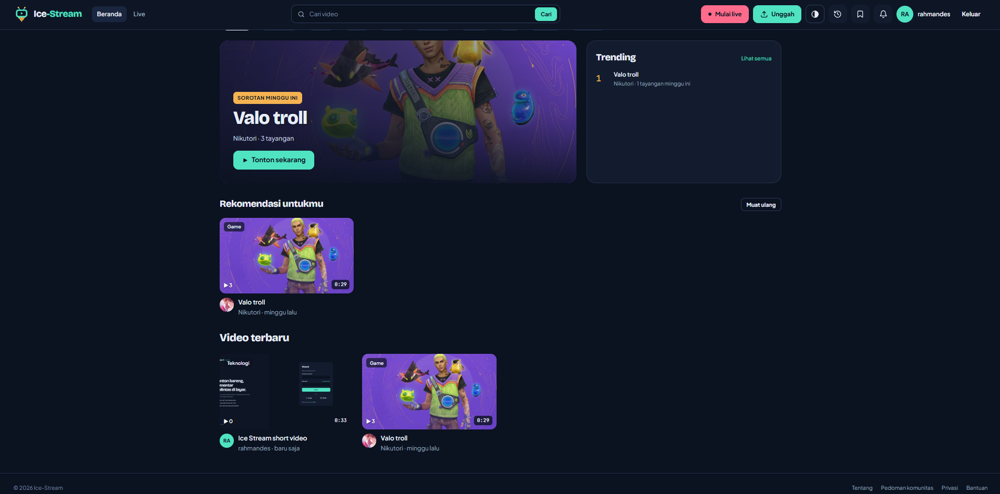
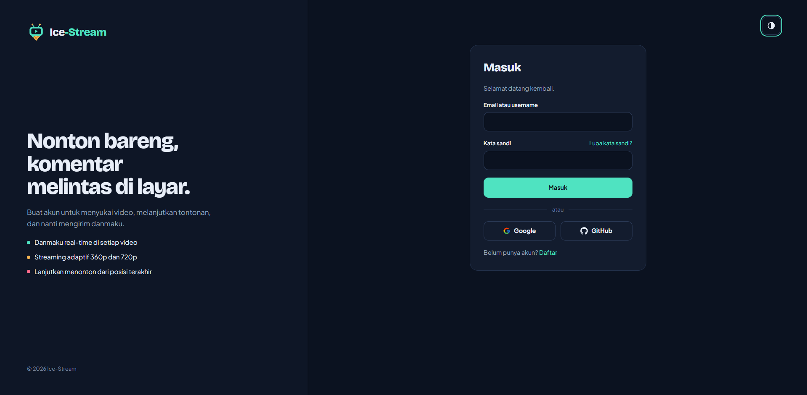
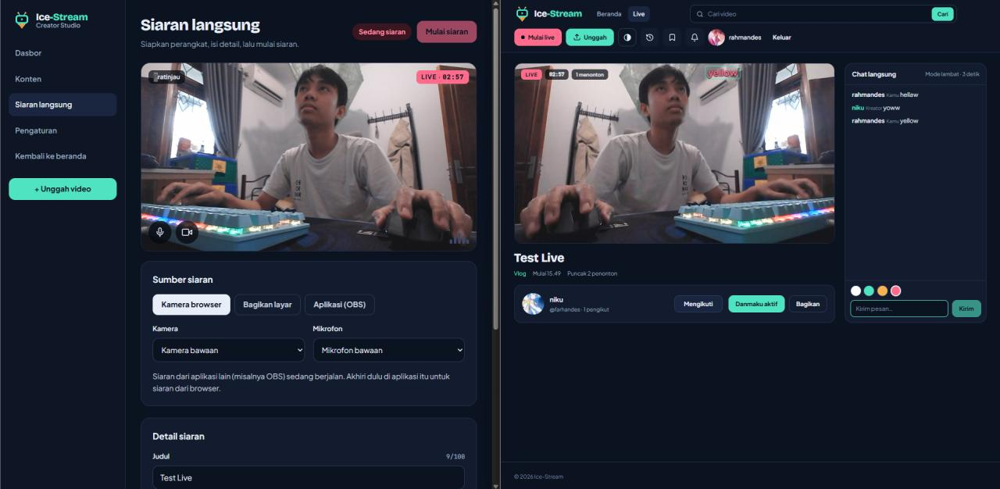
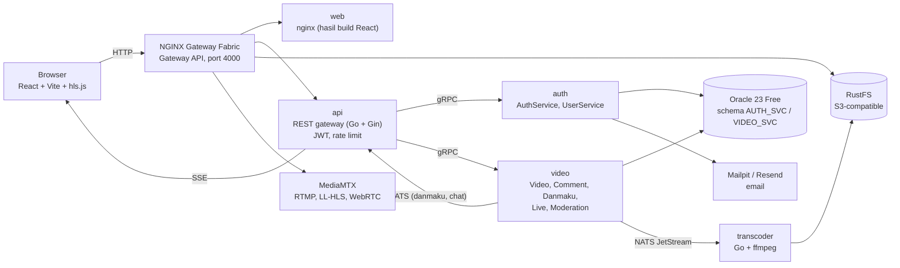
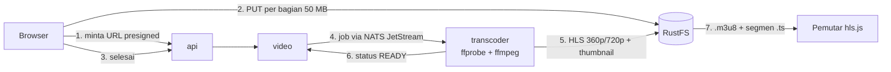
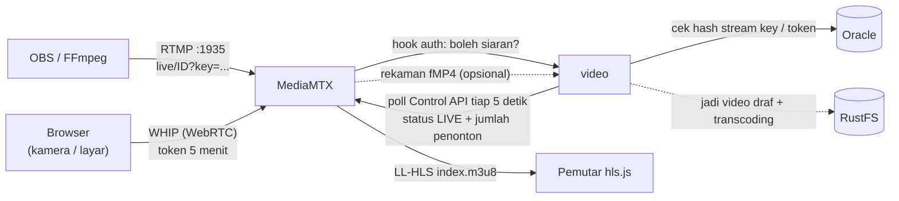
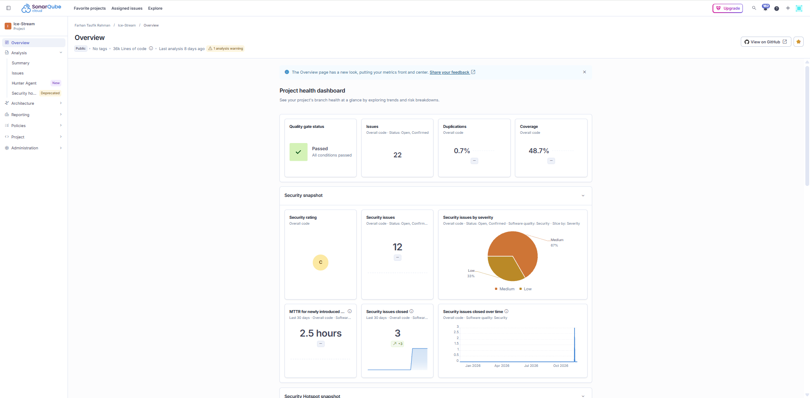
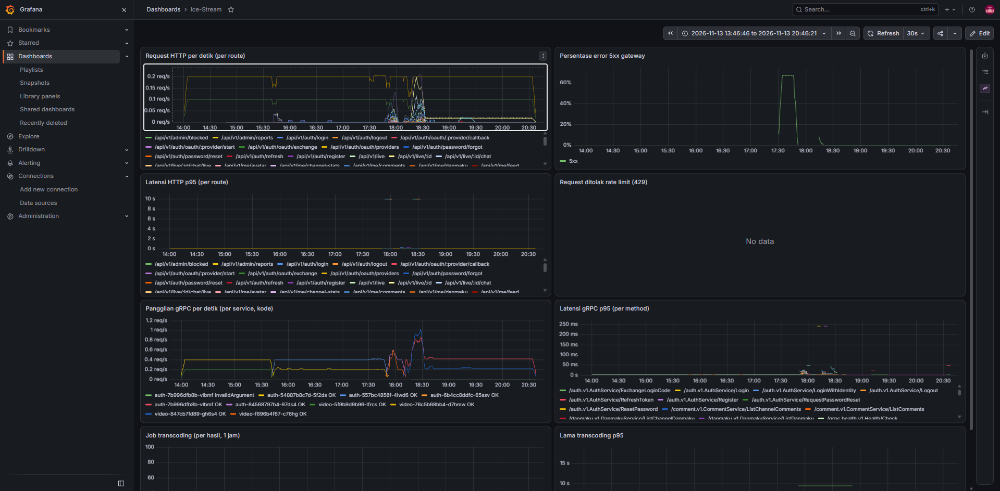
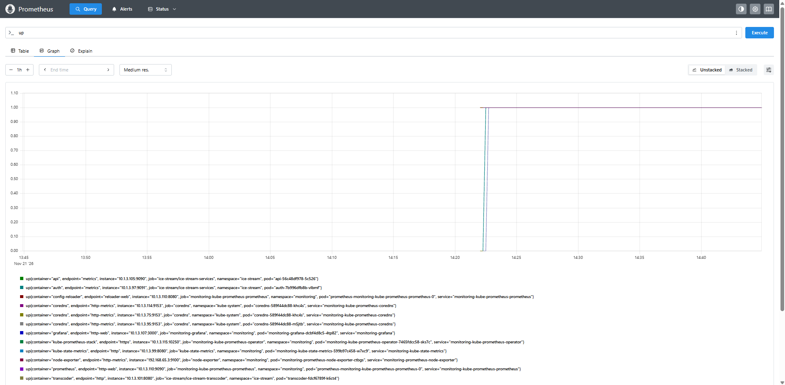

# 🧊 Ice-Stream

> Platform video dan siaran langsung bergaya Bilibili: unggah video dengan transcoding HLS adaptive bitrate, danmaku realtime, dan siaran langsung dari OBS (RTMP) atau langsung dari browser (WebRTC/WHIP). Dibangun sebagai microservice Go + gRPC di Kubernetes, dengan frontend React.

[](https://github.com/farhantaufikrahman/ice-stream/actions/workflows/ci.yml)
[](https://github.com/farhantaufikrahman/ice-stream/actions/workflows/cd.yml)



**Live demo:** https://icestream.vzkyrielight.my.id

## ✨ Fitur

- **Akun**: daftar, masuk, lupa kata sandi lewat email, masuk dengan Google atau GitHub. Access token JWT Ed25519 (15 menit) + refresh token di cookie httpOnly.
- **Unggah video**: langsung dari browser ke storage per bagian 50 MB (S3 multipart dengan URL presigned, bisa dilanjutkan jika koneksi putus), lalu transcoding otomatis ke HLS 360p dan 720p, pilihan thumbnail, visibilitas Publik/Tidak publik/Pribadi, dan draf.
- **Menonton**: pemutar HLS (hls.js), danmaku live lewat Server-Sent Events, komentar dan balasan, suka, Tonton nanti, playlist dengan putar berurutan, riwayat tonton yang mengingat posisi terakhir, bagikan dengan waktu mulai.
- **Penemuan**: beranda dengan rekomendasi, Trending 7 hari, pencarian video/kreator/playlist dengan pengurutan, kategori dan tag.
- **Kanal**: halaman kanal, ikuti kreator, notifikasi video baru.
- **Siaran langsung**: RTMP dari OBS/FFmpeg atau WHIP dari browser lewat MediaMTX, stream key per kreator yang bisa di-reset, jumlah penonton, chat siaran dengan mode lambat dan mode khusus pengikut, rekaman siaran (opsional) yang otomatis menjadi video draf.
- **Creator Studio**: dasbor, kelola konten, analitik tayangan harian, kelola komentar dan danmaku.
- **Moderasi (admin)**: antrean video yang dilaporkan, turunkan video dengan alasan, tolak laporan, pulihkan video. Pemilik video menerima notifikasi beserta alasannya.
- **Operasional**: rate limit di gateway, metrik Prometheus + dasbor Grafana, health/readiness probe, CI/CD GitHub Actions, analisis kode SonarQube Cloud.

## 🖼️ Tampilan

| Masuk                                | Unggah video                                         |
| ------------------------------------ | ---------------------------------------------------- |
|  |  |

**Siaran langsung**



## 🏗️ Arsitektur



| Komponen              | Teknologi                                                         | Alasan                                                                             |
| --------------------- | ----------------------------------------------------------------- | ---------------------------------------------------------------------------------- |
| Frontend              | React 19, React Router, Vite, hls.js, Vitest                      | hls.js memutar HLS di Chrome/Firefox/Edge (HLS bawaan browser hanya ada di Safari) |
| API gateway           | Go, Gin, `golang.org/x/time/rate`, Prometheus `client_golang`     | Satu pintu REST/JSON untuk browser: cek JWT, rate limit, terjemahkan ke gRPC       |
| Service               | Go, gRPC + Protocol Buffers (buf), GORM + godror                  | Kontrak antar-service yang diketik ketat dan cepat                                 |
| Database              | Oracle Database Free 23 + Flyway                                  | Satu schema per service (AUTH_SVC, VIDEO_SVC), migrasi berversi                    |
| Storage               | RustFS (S3-compatible)                                            | API S3 yang sama dengan AWS S3, jadi kodenya bisa pindah ke cloud                  |
| Antrean & realtime    | NATS JetStream                                                    | Antrean transcoding yang tahan restart, plus pub/sub danmaku dan chat              |
| Media server          | MediaMTX                                                          | Satu program untuk RTMP masuk, LL-HLS dan WebRTC keluar, plus hook auth            |
| Transcoding           | ffmpeg (libx264 + AAC)                                            | Standar industri untuk HLS                                                         |
| Infrastruktur         | Docker, Kubernetes (Docker Desktop), Gateway API, Kustomize, Helm | Lingkungan lokal yang sama bentuknya dengan produksi                               |
| Online                | Cloudflare Tunnel + DNS, Vercel, Resend                           | Backend tetap di laptop, frontend di CDN Vercel                                    |
| Kualitas & monitoring | GitHub Actions, SonarQube Cloud, Prometheus, Grafana              | Tes otomatis di setiap PR dan metrik yang bisa dipantau                            |

**Padanan di ekosistem lain.** Bagi yang terbiasa dengan Node.js: gateway berperan seperti aplikasi Express, interceptor gRPC seperti middleware Express, dan GORM seperti Sequelize/Prisma. Di Java, susunan ini mirip Spring Cloud Gateway di depan beberapa service Spring Boot yang saling memanggil lewat gRPC. Untuk media server, padanan MediaMTX (Go) di Node.js adalah node-media-server, di Java Ant Media Server atau Red5. Pilihan yang tidak bergantung bahasa seperti nginx-rtmp dan SRS juga umum dipakai.

## 🎞️ Pipeline media

### Video unggahan (VOD)



Status video berjalan `UPLOADED → PROCESSING → READY` (atau `FAILED` beserta alasannya).

**Bitrate ladder** (dari `backend/internal/transcoder/ffmpeg.go`):

| Rendisi | Tinggi | Video (H.264 Main, CRF 23) | Batas bitrate     | Audio                          |
| ------- | ------ | -------------------------- | ----------------- | ------------------------------ |
| 360p    | 360 px | libx264                    | maks 800 kbit/s   | AAC 128 kbit/s, stereo, 48 kHz |
| 720p    | 720 px | libx264                    | maks 2.800 kbit/s | AAC 128 kbit/s, stereo, 48 kHz |

Video yang lebih pendek dari 720 px tidak dibesarkan: transcoder hanya membuat rendisi yang tingginya tidak melebihi video asli. Segmen HLS berdurasi 6 detik dengan `independent_segments`, sehingga pemutar bisa berpindah kualitas di setiap batas segmen.

### Siaran langsung



### Protokol

| Bagian                        | Protokol                | Pengaturan di repo                                     |
| ----------------------------- | ----------------------- | ------------------------------------------------------ |
| Video unggahan                | HLS (VOD)               | Segmen 6 detik, dua rendisi (360p/720p)                |
| Siaran: masuk dari OBS/FFmpeg | RTMP                    | Port 1935, stream key dicek lewat hook auth            |
| Siaran: masuk dari browser    | WebRTC (WHIP, RFC 9725) | Token pendek berlaku 5 menit, video H.264              |
| Siaran: ditonton              | LL-HLS                  | Varian HLS bawaan MediaMTX (`hlsVariant` tidak diubah) |
| Danmaku dan chat siaran       | Server-Sent Events      | Disiarkan antar-pod lewat NATS                         |

Trade-off yang dipilih: HLS dengan segmen 6 detik cocok untuk video unggahan karena tahan terhadap jaringan yang naik-turun dan mudah di-cache. Untuk siaran, LL-HLS memecah segmen menjadi bagian kecil sehingga jeda ke penonton jauh lebih pendek, tetapi tetap memakai HTTP biasa sehingga bisa lewat Gateway dan Cloudflare Tunnel. WebRTC dipakai untuk sisi masuk dari browser karena kamera browser tidak bisa mengirim RTMP.

## 🚀 Menjalankan di laptop (Kubernetes lokal)

Perintah di bawah dijalankan di **Ubuntu (WSL)** dari folder `backend/`, kecuali disebut lain.

**Prasyarat**

| Alat                                   | Versi                                                                     |
| -------------------------------------- | ------------------------------------------------------------------------- |
| Docker Desktop dengan Kubernetes aktif | -                                                                         |
| `kubectl`                              | -                                                                         |
| Go                                     | 1.27.4 (baris `go` di `backend/go.mod`)                                   |
| Node.js                                | 22.22.0 atau lebih baru (`engines` di `frontend/package.json`)            |
| NGINX Gateway Fabric di cluster        | [panduan instalasi](https://docs.nginx.com/nginx-gateway-fabric/install/) |
| Akun Docker Hub                        | untuk menyimpan image                                                     |
| FFmpeg                                 | opsional, untuk mengetes tanpa kamera                                     |

**Langkah**

1. **Clone**:
   ```bash
   git clone https://github.com/farhantaufikrahman/ice-stream.git
   cd ice-stream/backend
   ```
2. **Rahasia** (tidak pernah di-commit):
   - Salin setiap `infra/k8s/secrets/*.env.example` menjadi `*.env` di folder yang sama, lalu isi password dan kuncinya.
   - Buat pasangan kunci JWT Ed25519 lalu salin ke `infra/k8s/secrets/`:
     ```bash
     mkdir -p secrets
     openssl genpkey -algorithm ed25519 -out secrets/jwt-private.pem
     openssl pkey -in secrets/jwt-private.pem -pubout -out secrets/jwt-public.pem
     cp secrets/jwt-private.pem secrets/jwt-public.pem ../infra/k8s/secrets/
     ```
   - Salin `backend/.env.example` menjadi `backend/.env` dan isi `DOCKERHUB_USER`.
3. **Build dan push image**:
   ```bash
   make docker-build docker-build-auth docker-build-video docker-build-transcoder docker-build-web migrate-build
   make docker-push docker-push-auth docker-push-video docker-push-transcoder docker-push-web migrate-push
   ```
4. **Pasang dan migrasi**:
   ```bash
   make k8s-up
   kubectl -n ice-stream rollout status statefulset/oracle --timeout=600s
   make k8s-migrate
   make k8s-migrate-video
   make k8s-restart
   ```
5. **Buka** http://ice-stream.localhost:4000, lalu daftar akun baru. Email (misalnya lupa kata sandi) muncul di http://mail.ice-stream.localhost:4000.
6. **Jadikan akun admin** (untuk menu Moderasi): `make k8s-make-admin USERNAME=namakamu`, lalu keluar dan masuk lagi.

Untuk mengembangkan frontend dengan hot reload, jalankan `npm install && npm run dev` di folder `frontend/`. Proxy Vite meneruskan `/api` ke gateway di port 4000 (lihat `frontend/.env.example`).

### Target `make` yang sering dipakai

Daftar lengkapnya ada di `backend/Makefile` (setiap target diberi komentar `##`).

| Target                                                   | Fungsi                                                                    |
| -------------------------------------------------------- | ------------------------------------------------------------------------- |
| `make k8s-up`                                            | Pasang atau perbarui semua manifest di namespace `ice-stream`             |
| `make k8s-migrate`, `make k8s-migrate-video`             | Jalankan migrasi Flyway untuk AUTH_SVC dan VIDEO_SVC                      |
| `make k8s-restart`                                       | Restart gateway, auth, video, dan transcoder supaya memakai image terbaru |
| `make k8s-logs`, `k8s-logs-video`, `k8s-logs-transcoder` | Lihat log secara live                                                     |
| `make k8s-make-admin USERNAME=...`                       | Jadikan user admin                                                        |
| `make run`, `run-auth`, `run-video`, `run-transcoder`    | Jalankan service langsung di laptop (tanpa image)                         |
| `make proto`                                             | Buat ulang kode Go dari file `.proto`                                     |
| `make fmt vet test-race`                                 | Rapikan, periksa, dan tes backend                                         |
| `make monitoring-up`                                     | Pasang Prometheus + Grafana                                               |
| `make deploy` / `make deploy-local`                      | Pindah ke versi online / kembali ke versi lokal                           |

Perbandingan: di Node.js perannya mirip `scripts` di `package.json` (`npm run dev`), di Java/Spring mirip `./mvnw spring-boot:run` atau `./gradlew bootRun`. Makefile adalah konvensi umum di proyek Go.

## 🎥 Mengetes tanpa kamera

Tidak perlu webcam, OBS, atau bucket S3 di cloud. Cukup FFmpeg dan cluster lokal di atas.

### 1. Video unggahan sampai terputar

Buat video uji 30 detik berisi pola warna dan nada 1 kHz:

```bash
ffmpeg -f lavfi -i testsrc=size=1280x720:rate=30 \
       -f lavfi -i sine=frequency=1000 \
       -t 30 -c:v libx264 -pix_fmt yuv420p -c:a aac -shortest test-720p.mp4
```

Buka http://ice-stream.localhost:4000/upload, unggah `test-720p.mp4`, tunggu status berubah menjadi siap (transcoder membuat 360p dan 720p), lalu putar dari halaman video. hls.js memilih 360p atau 720p secara otomatis sesuai kecepatan jaringan.

### 2. Siaran langsung lewat RTMP

1. Buka http://ice-stream.localhost:4000/studio/live, klik **Buat kunci stream**, lalu salin kuncinya. Bentuknya `<id>?key=<rahasia>`. Demi keamanan, kunci hanya ditampilkan sekali; jika lupa, buat kunci baru.
2. Kirim pola uji ke MediaMTX (tanda kutip wajib karena ada `?` di stream key):
   ```bash
   ffmpeg -re -f lavfi -i testsrc=size=1280x720:rate=30 \
          -f lavfi -i sine=frequency=1000 \
          -c:v libx264 -preset veryfast -tune zerolatency -g 60 -pix_fmt yuv420p \
          -c:a aac -b:a 128k \
          -f flv "rtmp://localhost:1935/live/<STREAM_KEY>"
   ```
3. Dalam beberapa detik siaran muncul di http://ice-stream.localhost:4000/live. Hentikan FFmpeg dengan `Ctrl+C` untuk mengakhiri siaran.

**Dengan OBS:** Settings → Stream → Service _Custom_, Server `rtmp://localhost:1935/live`, Stream Key diisi kunci dari halaman Studio.

**Dari browser:** di halaman Studio yang sama, pilih siaran dari kamera atau layar. Browser mengirim video lewat WHIP, tanpa aplikasi tambahan.

## ⚙️ Konfigurasi

Konfigurasi lokal ada di ConfigMap `infra/k8s/*/configmap.yaml`. Versi online menimpanya lewat overlay `infra/online/`. Rahasia ada di `infra/k8s/secrets/*.env` (contohnya `*.env.example`, yang di-commit hanya contohnya).

| Variable                            | Contoh (lokal)                                           | Keterangan                                                                                                |
| ----------------------------------- | -------------------------------------------------------- | --------------------------------------------------------------------------------------------------------- |
| `LIVE_INGEST_URL`                   | `rtmp://localhost:1935/live`                             | Alamat RTMP yang ditampilkan di Studio untuk OBS                                                          |
| `LIVE_PLAYBACK_URL`                 | `http://live.ice-stream.localhost:4000`                  | Alamat publik LL-HLS MediaMTX                                                                             |
| `LIVE_WHIP_URL`                     | `http://webrtc.ice-stream.localhost:4000`                | Alamat WHIP untuk siaran dari browser                                                                     |
| `LIVE_PUBLISH_TOKEN_TTL`            | `5m`                                                     | Masa berlaku token siaran dari browser                                                                    |
| `LIVE_POLL_INTERVAL` / `LIVE_GRACE` | `5s` / `15s`                                             | Seberapa sering status siaran dibaca, dan berapa lama koneksi boleh putus sebelum siaran dianggap selesai |
| `LIVE_BROADCAST_ADMIN_ONLY`         | `false`                                                  | `true` = hanya admin yang boleh siaran                                                                    |
| `MEDIA_PUBLIC_URL`                  | `http://media.ice-stream.localhost:4000/videos`          | Alamat publik file HLS dan thumbnail                                                                      |
| `MAX_UPLOAD_MB`                     | `2048`                                                   | Ukuran maksimal satu video                                                                                |
| `UPLOAD_URL_TTL`                    | `15m`                                                    | Masa berlaku URL presigned untuk upload                                                                   |
| `PLAYBACK_URL_TTL`                  | `1h`                                                     | Masa berlaku URL presigned file asli (hanya untuk pemilik video)                                          |
| `CORS_ALLOWED_ORIGINS`              | `http://localhost:5173,http://ice-stream.localhost:4000` | Origin yang boleh memanggil API dan bucket storage                                                        |
| `RATE_LIMIT_ENABLED`                | `true`                                                   | Nyalakan/matikan rate limit gateway                                                                       |

## 📁 Struktur folder

```
backend/
  cmd/            api, auth, video, transcoder (satu folder = satu program)
  internal/       logika tiap service, gateway (httpserver), livestream, transcoder, metrics
  proto/          kontrak gRPC (.proto); kode Go-nya di gen/ (make proto)
  migrations/     SQL Flyway: auth/, video/, bootstrap/
frontend/
  src/            halaman (pages/), komponen, API client, hooks, pemutar HLS, WHIP
  nginx/          konfigurasi nginx untuk image produksi
infra/k8s/        manifest Kubernetes versi lokal (kubectl apply -k), termasuk live/ (MediaMTX)
infra/online/     overlay versi online: Cloudflare Tunnel, alamat https, Resend
infra/monitoring/ nilai Helm Prometheus + Grafana, PodMonitor, dasbor
pictures/         tangkapan layar untuk README
.github/workflows ci.yml (tes + SonarQube), cd.yml (Docker Hub + Vercel)
```

## 🔐 Keamanan

**Siaran langsung**

- Setiap kali OBS atau browser mulai mengirim video, MediaMTX bertanya dulu ke VideoService lewat hook auth (`POST /mediamtx/auth`). Siaran baru diterima jika jawabannya "boleh".
- Stream key disimpan sebagai hash di database, bukan teks aslinya, dan bisa di-reset dari Studio kapan saja.
- Rahasia stream key berada di bagian query (`?key=...`) yang hanya dikirim ke hook auth. Alamat yang ditonton penonton hanya `live/<id>/index.m3u8`, jadi kuncinya tidak pernah terlihat oleh penonton.
- Siaran dari browser memakai token pendek (5 menit) yang dikirim sebagai `Authorization: Bearer`, bukan stream key permanen.
- Penonton tidak membebani database: aksi `read`/`playback` dikecualikan dari hook auth.

**Akun dan API**

- Access token JWT ditandatangani Ed25519 dan berlaku 15 menit. Refresh token disimpan di cookie httpOnly (tidak bisa dibaca JavaScript).
- Upload langsung ke storage memakai URL presigned berumur pendek (`UPLOAD_URL_TTL`), jadi browser tidak pernah memegang kredensial S3. File asli video hanya bisa diunduh pemiliknya lewat URL presigned (`PLAYBACK_URL_TTL`).
- Semua kredensial (Oracle, storage, OAuth, token tunnel, API key email) ada di file `.env` yang di-gitignore. Yang di-commit hanya `*.env.example`.
- Container berjalan sebagai user non-root dengan root filesystem read-only dan semua Linux capability dicabut.

**Rate limit** (gateway, `backend/internal/httpserver/ratelimit.go`). Formatnya "jatah awal, lalu isi ulang". Saat terlampaui, gateway menjawab `429` dengan header `Retry-After`.

| Aksi                           | Batas                   | Kunci    |
| ------------------------------ | ----------------------- | -------- |
| Masuk, daftar, lupa kata sandi | 10, lalu 1 per 6 detik  | per IP   |
| Refresh token                  | 30, lalu 1 per 2 detik  | per IP   |
| Buat video                     | 10, lalu 1 per 3 menit  | per user |
| URL bagian upload              | 30, lalu 1 per detik    | per user |
| Upload gambar                  | 10, lalu 1 per 10 detik | per user |
| Komentar                       | 10, lalu 1 per 3 detik  | per user |
| Danmaku dan chat siaran        | 10, lalu 1 per detik    | per user |
| Laporan                        | 5, lalu 1 per 30 detik  | per user |

Chat siaran juga punya mode lambat (1 pesan per 3 detik per user) dan mode khusus pengikut yang bisa dinyalakan kreator.

## 🧪 Tes, CI/CD, dan kualitas kode

```bash
# backend/ (WSL)
make fmt vet test-race
# frontend/ (WSL)
npm run lint && npm test && npm run build
```

- **CI** (`.github/workflows/ci.yml`) menjalankan tes backend dan frontend di setiap Pull Request ke `dev` dan `main`, lalu mengirim hasil tes dan coverage ke SonarQube Cloud.
- **CD** (`.github/workflows/cd.yml`) berjalan setelah merge ke `main`: menjalankan ulang CI, push image backend ke Docker Hub (tag `:main` dan `:sha-<commit>`), lalu deploy frontend ke Vercel. Semua action dikunci ke commit SHA.




## 📊 Monitoring

```bash
# backend/ (WSL). Butuh helm dan infra/k8s/secrets/grafana.env
make monitoring-up
make grafana-forward      # http://localhost:3000, dasbor "Ice-Stream"
make prometheus-forward   # http://localhost:9095, menu Status > Targets
```

Setiap service membuka metrik Prometheus di `GET /metrics` (hanya di dalam cluster): gateway port 9090, AuthService 9091, VideoService 9092, transcoder di port HTTP-nya (8080).

```bash
kubectl -n ice-stream port-forward deployment/api 9090:9090
curl -s localhost:9090/metrics | grep icestream_
```

| Grafana                                 | Prometheus                                    |
| --------------------------------------- | --------------------------------------------- |
|  |  |

## 🌐 Versi online

| Bagian                | Alamat                                                                                 | Jalan di                                             |
| --------------------- | -------------------------------------------------------------------------------------- | ---------------------------------------------------- |
| Frontend              | https://icestream.vzkyrielight.my.id                                                   | Vercel (di-deploy `cd.yml`)                          |
| API                   | https://api-icestream.vzkyrielight.my.id                                               | Kubernetes (Docker Desktop), lewat Cloudflare Tunnel |
| Media (HLS, foto)     | https://media-icestream.vzkyrielight.my.id                                             | sama                                                 |
| Upload video          | https://upload-icestream.vzkyrielight.my.id                                            | sama (langsung ke RustFS)                            |
| Siaran (LL-HLS, WHIP) | https://live-icestream.vzkyrielight.my.id, https://webrtc-icestream.vzkyrielight.my.id | sama                                                 |

Alur rilis: merge ke `main` → workflow **CD** menjalankan tes, push image `:main` ke Docker Hub, dan deploy frontend ke Vercel → di WSL jalankan `make deploy` (dari `backend/`) untuk memasang `infra/online/`, migrasi, dan restart service. `make deploy DEPLOY_TAG=dev` memakai image `:dev` dari laptop. `make deploy-local` mengembalikan cluster ke versi lokal.

Di versi online, Cloudflare memberi HTTPS dan `infra/online/` menyalakan `COOKIE_SECURE=true`. Siaran dilakukan oleh admin (`LIVE_BROADCAST_ADMIN_ONLY=true`), sedangkan menonton dan chat terbuka untuk semua orang. Rahasia versi online (tidak di-commit): `infra/online/secrets/cloudflared.env` (token tunnel) dan `infra/online/secrets/smtp.env` (API key Resend).

## 🛠️ Troubleshooting

| Masalah                                                | Solusi                                                                                                                                                                                               |
| ------------------------------------------------------ | ---------------------------------------------------------------------------------------------------------------------------------------------------------------------------------------------------- |
| Pemutar error CORS saat membuka `.m3u8` video unggahan | Tambahkan origin frontend ke `CORS_ALLOWED_ORIGINS` di `infra/k8s/video/configmap.yaml`, lalu `make k8s-up && make k8s-restart`. VideoService memasang aturan CORS bucket saat start.                |
| Pemutar error CORS saat menonton siaran                | Tambahkan origin ke `hlsAllowOrigins` dan `webrtcAllowOrigins` di `infra/k8s/live/configmap.yaml`, lalu `kubectl -n ice-stream rollout restart deployment/mediamtx`.                                 |
| Video tidak terputar di Safari/iPhone                  | Pastikan sumber siaran memakai H.264 + AAC (seperti perintah FFmpeg di atas). Video unggahan selalu di-transcode ke H.264 Main + AAC.                                                                |
| OBS/FFmpeg gagal connect ke `rtmp://localhost:1935`    | Cek Service RTMP mendapat alamat: `kubectl -n ice-stream get svc \| grep 1935` (Docker Desktop membuka Service `LoadBalancer` di localhost). Pastikan tidak ada program lain yang memakai port 1935. |
| Siaran ditolak padahal stream key benar                | Pastikan memakai kunci terbaru (kunci lama langsung tidak berlaku setelah dibuat ulang). Jika `LIVE_BROADCAST_ADMIN_ONLY=true`, akun harus admin. Detailnya ada di `make k8s-logs-video`.            |
| Siaran dari browser gagal dimulai                      | Browser harus bisa mengirim video H.264 (Chrome, Edge, atau Safari terbaru) dan izin kamera harus diberikan.                                                                                         |
| `ice-stream.localhost:4000` tidak bisa dibuka          | Cek Gateway: `kubectl -n ice-stream get gateway`. Jika statusnya menunggu controller, pastikan deployment NGINX Gateway Fabric berjalan: `kubectl -n nginx-gateway get deploy`.                      |
| Video tertahan di status PROCESSING                    | Lihat log transcoder: `make k8s-logs-transcoder`.                                                                                                                                                    |
